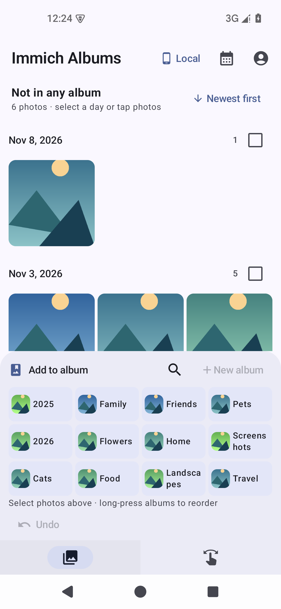
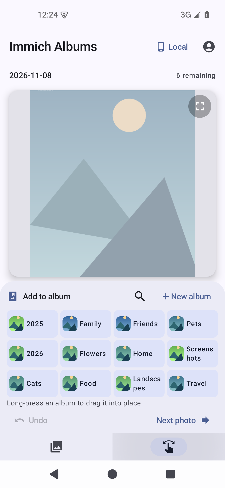

# Immich Albums · 相册整理版

面向 Immich 的 Android 相册整理工具：按时间浏览未归类的照片和视频，快速加入相册。

[下载正式版 APK · 3.0.4](https://github.com/sea-with-sakura/immich-swipe-android/releases/download/albums-v3.0.4/immich-albums-3.0.4.apk) · [版本说明](https://github.com/sea-with-sakura/immich-swipe-android/releases/tag/albums-v3.0.4)

| 按日期浏览未归类照片 | 点击相册，连续整理与撤回 |
| --- | --- |
|  |  |

实际应用截图，照片和相册使用演示数据。

- **从未归类照片开始**：首页按拍摄日期排列，支持最新／最早排序和日期跳转。
- **快捷加入相册**：单张、多选或整日批量归类，也能直接新建相册并加入；批量完成后自动回到待整理列表顶部。
- **连续整理**：Swipe 页常驻相册按钮，添加成功后自动显示下一张，已归类照片移出待整理队列。
- **更多相册，一眼找到**：紧凑网格显示封面，支持长按拖动排序，顺序按账号保存。
- **操作可撤回**：Undo 可撤回单张或整批归类，照片回到待整理队列；撤回记录保留在当前应用会话中。
- **简洁界面**：精简照片工具，底部采用纯图标导航，保留 Next photo 快速跳过。

使用自己的 Immich 服务器地址和 API Key 登录。独立应用名与包名，可与原版并存。

致敬原项目 Immich Swipe 及其作者，感谢优秀的界面与基础功能，原版介绍见 [原项目 README](https://github.com/Minos2020/immich-swipe-android#readme)。

沿用 [GPL-3.0 许可证](LICENSE)。
