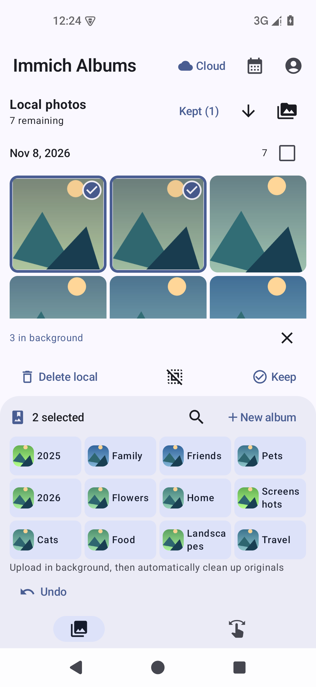
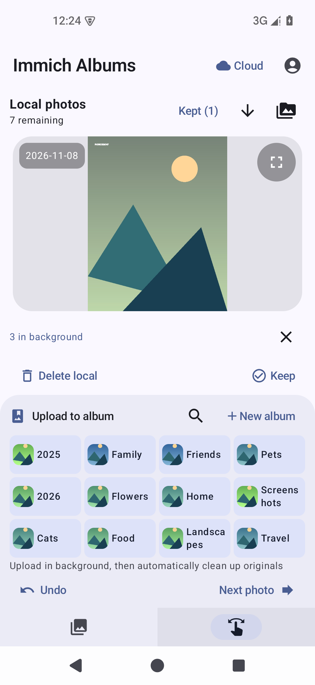

# Immich Albums · 相册整理版

面向 Immich 的 Android 相册整理工具：按时间浏览未归类的照片和视频，快速加入相册。

[下载正式版 APK · 3.2.0](https://github.com/sea-with-sakura/immich-swipe-android/releases/download/albums-v3.2.0/immich-albums-3.2.0.apk) · [版本说明](https://github.com/sea-with-sakura/immich-swipe-android/releases/tag/albums-v3.2.0)

| Cloud · 云端整理 | Local · 本机整理 |
| --- | --- |
|  |  |
|  |  |

实际应用截图，照片和相册使用演示数据。

- **Local / Cloud 一键切换**：右上角切换本机与云端，沿用首页和 Swipe；本机支持左滑删除、右滑保留，也可批量上传到指定相册。
- **后台上传、自动清理**：点击相册后立即继续整理，切换页面、锁屏也可继续传输。Android 12 及以上按提示完成照片与“媒体管理”授权后，归档校验成功即自动清理本机原图，无需逐张确认。未授权时集中待清理，失败保留原图。
- **从未归类照片开始**：首页按拍摄日期排列，支持最新／最早排序和日期跳转。
- **快捷加入相册**：单张、多选或整日批量归类，也能直接新建相册并加入；批量完成后自动回到待整理列表顶部。
- **连续整理**：Swipe 页常驻相册按钮，添加成功后自动显示下一张，已归类照片移出待整理队列。
- **更多相册，一眼找到**：紧凑网格显示封面，支持长按拖动排序，顺序按账号保存。
- **操作可撤回**：云端 Undo 可撤回单张或整批归类，本机可撤回保留；撤回记录保留在当前应用会话中。
- **简洁界面**：精简照片工具，底部采用纯图标导航，保留 Next photo 快速跳过。

系统回收应用界面后，上传任务仍会保存并继续调度，未完成的清理在下次打开时继续；旧版 Android 使用集中清理入口。

使用自己的 Immich 服务器地址和 API Key 登录。本机上传额外需要 `asset.upload` 权限。独立应用名与包名，可与原版并存。

致敬原项目 Immich Swipe 及其作者，感谢优秀的界面与基础功能，原版介绍见 [原项目 README](https://github.com/Minos2020/immich-swipe-android#readme)。

沿用 [GPL-3.0 许可证](LICENSE)。
